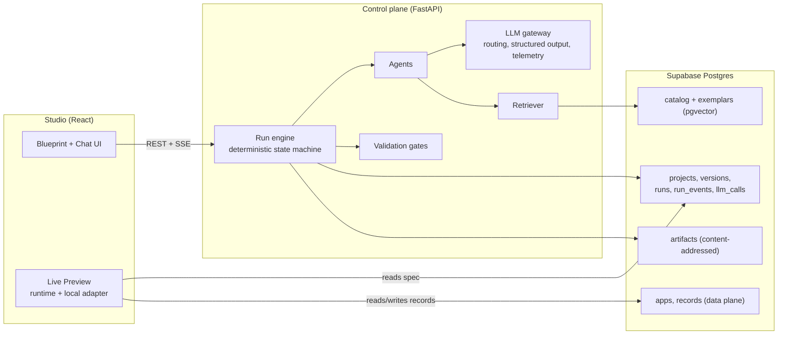
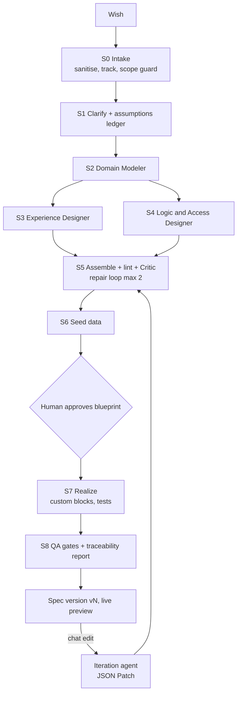

# Intara v2 — Architecture & Build Guide

> **What this is:** the target architecture and a build plan to turn Intara from "a pipeline that fills CRUD templates" into a system that **understands a request, plans it in stages, and produces a unique, validated, working app** — with a precoded component library, RAG, and a multi-agent orchestrator.
> **Basis:** `PROJECT_SPEC_FOR_PLANNING_AGENT.md` (server ~4.7k lines, 93 tests green, eval 5/5). I have **not** read the code itself — every file path marked *(proposed)* is a suggestion, and every statement about current behaviour comes from that spec. Where code and this guide disagree, trust the code and fix the guide.
> **Effort unit:** 1 week ≈ 20 focused hours, solo, AI-assisted development. Double the calendar time if you can only give ~10 h/week.

---

## Contents

0. [TL;DR — the six decisions](#0-tldr--the-six-decisions)
1. [Honest diagnosis of where you are](#1-honest-diagnosis-of-where-you-are)
2. [Product definition, guarantees, and what "arbitrary" can mean](#2-product-definition-guarantees-and-what-arbitrary-can-mean)
3. [Target architecture](#3-target-architecture)
4. [The App Spec — the heart of the system](#4-the-app-spec--the-heart-of-the-system)
5. [The Runtime (data plane)](#5-the-runtime-data-plane)
6. [Block catalog & composition](#6-block-catalog--composition)
7. [Multi-agent build pipeline (control plane)](#7-multi-agent-build-pipeline-control-plane)
8. [LLM gateway & structured output (the JSON-mode fix, generalised)](#8-llm-gateway--structured-output)
9. [Validation pyramid — what "validated" means](#9-validation-pyramid--what-validated-means)
10. [RAG, exemplars, and "training"](#10-rag-exemplars-and-training)
11. [Freeform track: games, tools, custom blocks](#11-freeform-track-games-tools-custom-blocks)
12. [Database re-architecture](#12-database-re-architecture)
13. [Studio UX for non-technical users](#13-studio-ux-for-non-technical-users)
14. [Code export, hosting, multi-tenancy (later)](#14-code-export-hosting-multi-tenancy-later)
15. [Repo layout & migration map](#15-repo-layout--migration-map)
16. [Roadmap: milestones, tasks, acceptance criteria](#16-roadmap-milestones-tasks-acceptance-criteria)
17. [Evaluation & metrics](#17-evaluation--metrics)
18. [Security & safety](#18-security--safety)
19. [Free-tier operating plan](#19-free-tier-operating-plan)
20. [Breaking changes & preserved invariants](#20-breaking-changes--preserved-invariants)
21. [Risks, open questions, what to freeze or delete](#21-risks-open-questions-what-to-freeze-or-delete)
- [Appendix A — Example App Spec](#appendix-a--example-app-spec)
- [Appendix B — Block definition example](#appendix-b--block-definition-example)
- [Appendix C — Agent contract example](#appendix-c--agent-contract-example)
- [Appendix D — Golden domain list](#appendix-d--golden-domain-list)
- [Appendix E — Control-plane DDL sketch](#appendix-e--control-plane-ddl-sketch)

---

## 0. TL;DR — the six decisions

| # | Decision | Recommendation | Why |
|---|---|---|---|
| 1 | **What the LLM produces** | A small, schema-validated **App Spec (JSON)** — not thousands of lines of TSX/Python | Your measured result was 21 failed LLM attempts / 0 parse successes on a full Gemini build, i.e. every "generated" app was really a template. Large code-inside-JSON outputs are the likeliest cause; small typed specs are what LLMs do reliably. |
| 2 | **How the app runs** | A shared **Runtime** (React renderer + data engine) interprets the spec. Real code is a *compile target* (export), not the primary artifact | You validate the engine once (in CI) and each app as *data*. Preview is instant, edits are JSON Patches, hosting later is one deployment instead of one per app. |
| 3 | **Where uniqueness comes from** | Composition: domain model + lifecycle + roles + automations + page/block layout + theme + copy, chosen per request from a **block catalog** via retrieval | Uniqueness without randomness. Two different businesses get different data models, workflows, screens and look — all from vetted parts. |
| 4 | **Arbitrary apps (games, odd tools)** | A second **Freeform track**: sandboxed single-app code generation, best-effort guarantees, plus a **custom-block escape hatch** inside Track A | Be honest: you can guarantee quality on Track A; Track B is "works, sandboxed, smoke-tested". |
| 5 | **Orchestration** | Keep your DAG idea; replace in-memory state with a **durable run engine** (event-sourced `run_events`, content-addressed artifacts, deterministic state machine, LLM only inside agents) | Fixes "content-hollow resume", gives replay, cost accounting, and resumability. No framework needed. |
| 6 | **RAG / training** | RAG over **(a) the block catalog, (b) hand-authored gold specs, (c) UX patterns**. Collect data now; fine-tune later (small model, spec-only) | RAG on curated specs gives most of the gain at $0. Training on raw app code has poor ROI and licence risk once the spec is the product. |

**Minimum viable "it really works" slice = Milestones M0–M3 + a thin M5 (≈ 12–13 weeks).** After that you can demo: *type a wish → see a clarified plan → get a live, distinct, working app with seeded data*.

---

## 1. Honest diagnosis of where you are

**What is genuinely good (keep):**
- Staged flow with persistence, SSE + polling, retry, per-step prompts stored, single-flight guard, fail-closed `_mark_build_failed`.
- Blocking gates (tsc/vite, TestClient CRUD matrix, contract checks) — rare in hobby builders; this *is* the foundation of "validated".
- Component catalog with lifecycle (`planned → experimental → stable`) and composer (topological order, conflicts, cycles).
- Clarify-first with a score, iterate with diff-first patches + revert, deterministic templates (byte-stable → golden tests).
- 93 tests, eval 5/5, LLM fallback chain with cooldowns.

**What blocks "a proper working product" (fix, in this order):**

1. **The generator is mostly not generating.** 21 failed attempts / 0 parse successes ⇒ the system silently ships templates. Until this is fixed every other improvement is invisible. Also: *silent* fallback means your eval can pass 5/5 while the product does nothing intelligent.
2. **Output shape is the wrong unit.** One LLM call per page/table, returning code (sometimes 2 files) inside JSON, then regex/AST repair. Escape/control-character failures are expected there. The model also never *sees the whole app*, so cross-file wiring is enforced afterwards by gates rather than designed upfront.
3. **Contract IR is CRUD-shaped.** The `appKind: crud | interactive` split, `GAME_WORDS` keyword routing, `mock_game_plan`, "crud pages must bind a table" — these encode the idea that an app is tables + list/detail pages. That is why everything looks like a CRUD template. Real SMB tools need lifecycles/statuses, roles, computed fields, automations, calendars, reports.
4. **State lives in memory.** `wish_steps.output` stores file *paths*, contents live in the build process; a restart re-generates. Breaks resume, replay, diff history, and cost accounting.
5. **No requirement → implementation traceability.** `requirements.functional[]` are generated but nothing proves the built app satisfies them. "Nothing random" needs this.
6. **Demo-grade security/tenancy** — fine today (single user), but design for it now (owner columns, workspace ids) because retrofitting is painful.

> **Principle from this diagnosis:** *make failure visible, make outputs small, make state durable, make apps data.*

---

## 2. Product definition, guarantees, and what "arbitrary" can mean

**Product (one sentence):** *Describe the tool your business needs in plain language; Intara interviews you briefly, shows a plan you can approve, then builds a working, hosted-ready app you can edit by chatting.*

**Two tracks, two honesty levels:**

| | Track A — Business Apps | Track B — Freeform Apps |
|---|---|---|
| Examples | inventory, CRM, bookings, job tracker, leave/HR, invoicing, helpdesk, clinic, school fees | games, calculators, landing pages, one-off utilities, visualisations |
| Built as | App Spec → Runtime | Sandboxed code (React/vanilla) in an iframe |
| Guarantees | Schema-valid, semantically linted, requirement-traced, permission-tested, runtime-smoke-tested | Builds, renders without errors, passes generated interaction smoke test, no network access |
| Editing | JSON Patch (precise, undoable) | Diff-first code patches (current iterate flow) |
| Hosting later | One shared runtime | Static bundle |
| Expected coverage | ~80–90 % of SMB internal-tool requests | The long tail, lower reliability |

**"Arbitrary app" definition** — Track A can produce *any app expressible as*: entities + relations + enums + lifecycles + computed fields + roles/permissions + automations + pages composed of catalog blocks + theme. Anything outside that (e.g. a custom 3D viewer inside a CRM) uses a **custom block** (sandboxed code against a stable SDK) or goes to Track B. Growing the catalog is how Track A's coverage grows — and that is a tractable, measurable, ongoing job.

**Non-negotiable product invariants:**
1. **No silent fallback.** A fallback is a labelled "degraded" result with `fallback_reason`; live evals count it as a failure.
2. **Every build has a build report:** requirements → spec elements → tests, plus assumptions and warnings.
3. **Every edit is a version.** Immutable spec versions, undo = pick a parent.
4. **The LLM never executes anything.** It emits data (spec/patch) or sandboxed code; deterministic code applies and validates it.

---

## 3. Target architecture

### 3.1 System view



### 3.2 Two planes

- **Control plane (Python/FastAPI, keep):** turns a wish into a validated spec version. Agents, retrieval, gates, run engine, evals. Never serves end-user app traffic.
- **Data plane (TypeScript):** `@intara/runtime` renders a spec and operates on records through a **DataEngine** (validation, defaults, computed fields, refs, lifecycle transitions, permission checks) over a pluggable **StorageAdapter** (`memory`, `dexie` for preview, `supabase` for persistence). Same code runs in the browser preview and later in an Edge Function for server-authoritative writes.

Sharing the spec between languages: author **JSON Schema once** (`packages/spec`), generate Pydantic models (`datamodel-code-generator`) and TS types (`json-schema-to-typescript`). CI fails if generated files drift.

### 3.3 Build pipeline view



S3 and S4 depend only on S2, so they can run in parallel (cap concurrency at 2 on free tiers).

---

## 4. The App Spec — the heart of the system

The spec is the single source of truth: what agents write, gates check, the runtime executes, the Studio visualises, iteration patches, and export compiles. **Spend the most design time here.**

### 4.1 Top-level shape (v1)

```text
AppSpec
├─ spec_version         "1.0"
├─ app                  name, tagline, domain, locale, currency, timezone
├─ personas[]           who uses it + goals
├─ requirements[]       R1..Rn  (text, priority, persona)         ← traceability anchors
├─ assumptions[]        things the system decided without asking   ← shown to user
├─ model
│  ├─ enums[]           id, values[{value,label,color}]
│  └─ entities[]        id, label, fields[], display, lifecycle?, indexes?
├─ access
│  ├─ roles[]           id, label
│  └─ rules[]           entity × role × ops, optional row filter ("owner == $user")
├─ ui
│  ├─ theme             tokens (palette, radius, density, font pair), archetype
│  ├─ nav[]             sidebar/top items → pages
│  └─ pages[]           id, route, title, roles, layout, blocks[]   ← block instances
├─ automations[]        trigger → conditions → steps
├─ seed                 entity → rows (relational, realistic)
├─ integrations[]       email, file storage, webhooks (only `stable` ones)
└─ trace[]              requirement → [spec element ids]           ← filled by Critic + gates
```

### 4.2 Design rules

1. **Everything has a stable `id`** (snake_case, unique within kind). Patches and traceability reference ids, never array indexes.
2. **References are by id and validated:** field `ref` → entity exists; block `entity` → exists; page role → role exists; nav → page exists. A `ref` field may declare `relation_name` to expose the reverse accessor (e.g. `job.parts`) for formulas and related-list blocks.
3. **Field types (closed set):** `text, longtext, int, decimal, money, bool, date, datetime, time, enum, multi_enum, ref, multi_ref, email, phone, url, file, image, rating, color, json`. Each has: validation, input widget, display widget, filter operator set, sort behaviour, CSV import/export behaviour — defined **once** in the catalog, not per app.
4. **Computed fields use a tiny formula language** (`qty * unit_price`, `sum(parts.total)`, `if(status == "ready", due_date, null)`), parsed into an AST and evaluated by an in-house evaluator (TS; Python port only if needed). **Never `eval`.** LLMs write formula strings well; the parser validates them (unknown field ⇒ lint error).
5. **Lifecycle is first-class:** `lifecycle: {field, initial, states[], transitions[{id,from,to,label,roles,guard}]}`. This one concept replaces a lot of CRUD sameness (status pipelines, approvals, order flows).
6. **Blocks never contain data or code**, only `type`, `props` (validated against the block's JSON Schema) and bindings to entities/fields.
7. **Automations are declarative:** triggers `record.created | record.updated | lifecycle.transition | schedule | manual_button`; steps `set_field | create_record | send_email | notify | webhook | export_csv`. No arbitrary code in v1.
8. **Size budget:** a typical spec is 3–12 KB. If a step needs >6k output tokens, split the agent, don't raise the limit.
9. **Versioning:** `spec_version` follows semver; ship migrators (`1.0 → 1.1`) so old versions stay openable.

### 4.3 Iteration = JSON Patch (RFC 6902)

Because everything has an id and the spec is pure data, an edit like "add a due date to jobs and show overdue ones in red" becomes a validated patch:
`add /model/entities/job/fields/-`, `add /ui/pages/jobs/blocks/0/props/row_style`, plus a human-readable summary. Gates re-run on the *patched* spec only. Undo = switch to parent version. This replaces SEARCH/REPLACE code patches for Track A (keep them for Track B).

See [Appendix A](#appendix-a--example-app-spec) for a full example.

---

## 5. The Runtime (data plane)

### 5.1 Packages

```text
packages/runtime (proposed)
├─ engine/        validate(record), defaults, computed, refs(onDelete), lifecycle, permissions, formulas
├─ adapters/      memory.ts · dexie.ts (preview) · supabase.ts (persisted)  — all implement StorageAdapter
├─ blocks/        React implementation of each catalog block (+ props schema re-export)
├─ shell/         AppShell: auth stub, nav, theme tokens → CSS vars, routing from spec
├─ automation/    trigger matching + step executors (client-side now; Edge Function later)
└─ testing/       fixtures, spec-driven test generator (see §9)
```

### 5.2 StorageAdapter contract (keep it tiny)

```ts
interface StorageAdapter {
  list(entity: string, q: Query): Promise<Page<Rec>>;     // filter, sort, search, paginate, aggregate
  get(entity: string, id: string): Promise<Rec | null>;
  put(entity: string, rec: Rec, expectedVersion?: number): Promise<Rec>;
  remove(entity: string, id: string): Promise<void>;       // soft delete
  transaction<T>(fn: (tx: StorageAdapter) => Promise<T>): Promise<T>;
}
```
The **engine** wraps the adapter, so validation/refs/computed/lifecycle behave identically in preview and production.

### 5.3 Data storage decision (ADR-2)

| Option | How | Pros | Cons |
|---|---|---|---|
| **A. Shared `records` table, JSONB `data`** (recommended for v1) | `records(app_id, entity, id, data jsonb, …)` + GIN + expression indexes for fields marked `index: true` | Schema changes are metadata edits (no DDL, no migrations); trivially multi-tenant; fits free-tier (one project); same shape in Dexie | Referential integrity enforced by engine/RPC, not FKs; heavy analytics need care |
| B. Real tables per app (schema-per-app) | Generate DDL + RLS per app | "Real database"; FK integrity | Dynamic DDL in a shared free project is risky; migrations on every edit; hurts 500 MB / 2-project free limits |
| C. Hybrid | A now, *promote* hot entities to real tables later | Best long-term | More code; do only when a customer needs it |

**Recommendation: A, with C as an export/graduation path** (the export compiler emits real DDL from the spec — see §14). Consequence to accept: server-authoritative integrity needs the engine to run server-side (Edge Function or plpgsql) before multi-tenant launch. In single-user local mode, client-side engine is fine.

### 5.4 Permissions

`access.rules` compile to two layers: (1) **engine checks** (UI hides/disables, writes rejected); (2) later, **Postgres RLS** on `records` using a security-definer helper `intara_can(app_id, entity, op)` that reads the pinned spec version and the caller's role. Until multi-tenant, only layer 1 is required — but the spec must already express roles/rules so nothing changes later.

### 5.5 What the runtime deliberately does *not* do (v1)
Realtime collaboration, offline sync, custom SQL, arbitrary server code, payments. Each is a catalog/`planned` item with a promotion path (§6.3).

---

## 6. Block catalog & composition

### 6.1 Evolve your existing catalog (don't discard it)

Your lifecycle (`planned/experimental/stable`), fail-closed registry, and composer are right. Change the *unit*: from "generator units that emit files" to **blocks that render from props** (plus codegen templates for export).

**Mapping from today's 19 components:**

| Today | Becomes |
|---|---|
| `crud-entity`, `auth-users`, `booking-slot`, `scores-table` | Spec **entities** (+ lifecycle / role features), not components |
| `list-page`, `detail-page`, `dashboard-page` | Blocks `data.table`, `data.cards`, `record.detail`, plus page layouts |
| `stat-cards`, `kanban-board`, `charts` | Blocks `metric.stat`, `data.kanban`, `chart.*` |
| `crud-api`, `scores-api`, `search-api` | Engine capabilities (list/filter/search) — no per-app API code |
| `csv-export`, `file-upload`, `supabase-auth` | Field type `file/image`, action `export.csv`, runtime auth module |
| `game-board`, `scores-list` | Track B templates / custom blocks |

### 6.2 Starter block set (aim ~30; ★ = needed for M2)

| Category | Blocks |
|---|---|
| Data views | ★`data.table`, ★`data.cards`, ★`data.kanban`, `data.calendar`, `data.timeline`, `data.gallery`, `data.pivot` |
| Record | ★`record.detail`, ★`record.form`, `record.wizard`, `record.related_list`, `record.activity_log`, `record.timeline` |
| Metrics & charts | ★`metric.stat`, ★`chart.bar`, `chart.line`, `chart.pie`, `report.summary` |
| Inputs & filters | ★`filter.bar`, ★`search.box`, `input.file`, `input.rating`, `input.signature` |
| Workflow | ★`lifecycle.pipeline`, `workflow.approval`, `checklist` |
| Layout | ★`layout.sidebar`, `layout.topnav`, `layout.tabs`, `layout.split`, `layout.section`, `layout.hero` |
| Actions | ★`action.button` (runs automation), `action.export_csv`, `action.import_csv`, `action.print` |
| Content | `content.richtext`, `content.faq`, `content.pricing` (for showcase/landing pages) |

### 6.3 Block definition requirements (all must exist to be `stable`)

1. `id`, `version` (semver), `status`, `category`, `summary`.
2. **`when_to_use` / `when_not_to_use`** — prose written for the *retrieval + LLM*, not for humans only.
3. **`props_schema`** (JSON Schema) with defaults; **`binds`** declaring what it needs (`entity`, `field_types`, `lifecycle?`).
4. `requires` / `conflicts` (existing composer semantics).
5. Runtime implementation + **fixtures** (3 example prop sets) used by tests and by the LLM as few-shot.
6. Accessibility notes (keyboard, labels, contrast) and responsive behaviour.
7. Export template (for §14) — may be absent while `experimental`.
8. Tests: render with fixtures; empty/loading/error states; large data.

**Promotion path (unchanged idea):** `planned` (unselectable, loud error) → `experimental` (selectable with warning) → `stable` (runtime + tests + export template). Custom blocks that get reused 3+ times become promotion candidates.

### 6.4 Composition without CRUD sameness

The Experience Designer chooses **page archetypes**, not tables→pages:
`dashboard-first`, `pipeline-board`, `inbox/queue`, `calendar-centric`, `catalog+detail`, `wizard-intake`, `report-centric`, `single-tool`, `landing/showcase`. Each archetype is a small recipe (layout + typical blocks + nav pattern) held in the catalog as retrievable data. Combined with **theme tokens** (palette, density, radius, font pair, icon style) and **domain copy** (labels, empty states, help text), apps look and behave differently *because their structure differs*, not because an LLM improvised markup.

---
## 7. Multi-agent build pipeline (control plane)

### 7.1 Principles

- **Agents are functions with contracts**, not chatty personas: `(typed input) → (typed output)`, each with its own prompt, model tier, retrieval, gate, and failure policy.
- **The orchestrator is deterministic code**, not an LLM. It decides order, retries, budgets, and when to ask the human.
- **Agents see slices, not history.** Each gets a compact app summary + only the spec slice it needs (`spec_slice(spec, "model")`).
- **Small outputs.** One focused JSON object per call. Never code-inside-JSON (see §8).
- **Parallelise only what is independent** (S3 ∥ S4), concurrency ≤ 2 on free tiers.

### 7.2 Agent roster

| Stage | Agent | Input | Output (schema-validated) | Model tier | Retrieval | Gate after |
|---|---|---|---|---|---|---|
| S0 | **Intake** | raw wish | `{clean_wish, track, scope, risk_flags, language}` | fast | – | injection/size/safety checks; scope guard ("too big → propose phase-1 MVP") |
| S1 | **Clarifier** | clean wish | `{questions≤3, assumptions[]}` — questions only for high-impact unknowns | fast | exemplar domains | shape check; assumptions shown, editable |
| S2 | **Domain Modeler** | wish + answers + assumptions | `model` (enums, entities, fields, relations, lifecycles) | strong | similar gold specs | G0 schema, G1 lint (refs, naming, field-type fit) |
| S3 | **Experience Designer** | model + personas | `ui` (theme, archetypes, nav, pages, block instances) | strong | block catalog + archetype recipes | G0, G1 (every entity reachable, every page has data) |
| S4 | **Logic & Access Designer** | model (+ui summary) | `access`, `automations`, computed-field formulas, validations | strong | action catalog | G0, G1 (formula parses, roles exist, no unreachable states) |
| S5 | **Assembler (code) + Critic (LLM)** | all slices + requirements | merged spec + `trace[]` + critique list | Assembler: none; Critic: strong | – | G0–G2; repair loop ≤ 2 with *specific* error feedback |
| S6 | **Seed Writer** | model + domain | `seed` rows (relational, realistic, locale-aware) | fast | – | engine validates every row; FK-consistent |
| S7 | **Custom Block Coder** *(only if needed)* | block request + SDK docs | files via delimiter format | strong | SDK examples | tsc + sandbox render |
| S8 | **QA** *(mostly code)* | spec | generated test plan → run → report | code + fast | – | G3–G5 (§9) |
| Edit | **Iteration Agent** | instruction + spec slice + chat context | JSON Patch + human summary | fast→strong on retry | catalog | G0–G2 on patched spec |
| Chat | **Explainer** | question + spec | answer + action chips | fast | runtime docs | never blocks builds |

**Why the Critic matters:** it checks the *merged* spec against `requirements[]`: "R3 says staff must be notified when a job is ready — which automation satisfies it?" It fills `trace[]`; anything unsatisfied becomes a repair instruction, not a silent omission.

### 7.3 Clarify → assumptions ledger

Replace "blocking Q&A until score ≥ 70" with: ask **≤3 questions** only where the answer changes structure (e.g. "do customers log in?"), and write every other decision into an **assumptions ledger** the user sees on the blueprint ("Assumed: single branch, INR, no online payments"). Faster for non-technical users, and assumptions become test targets. Keep `score_prompt()` as a cheap pre-filter.

### 7.4 Run engine

```text
run(project, base_version, kind)
  steps = plan(kind)                      # DAG of (step_key, agent, deps)
  for each ready step (concurrency ≤ 2):
      input  = build_input(step)          # spec slice + retrieved context
      key    = hash(agent_version, prompt_version, input)
      cached = artifacts.get(step_key, key)           # replay / resume for free
      out    = cached or agent.run(input)             # writes run_events + llm_calls
      gate(out) → ok | repair(error_list) ≤ N | degrade(fallback_reason) | fail
      persist(step, out_hash)             # content-addressed artifact
  assemble → spec_version (immutable) → emit build report
```

- **Durable by construction:** every step output is a content-addressed artifact; `run_steps` stores hashes, not paths. Kill the process mid-build → restart → only missing steps rerun. (Fixes the "hollow resume" regeneration.)
- **Event-sourced:** `run_events` append-only; SSE streams from it; the polling fallback reads the same table; a finished run can be *replayed* in the UI.
- **Budgets per run:** `max_llm_calls`, `max_tokens`, `max_wall_seconds`, `max_repairs_per_step`. Exceeding a budget ends the run in a clear `degraded` or `failed` state with the reason.
- **Queue:** v1 = in-process worker but all state in Postgres + a startup sweeper that marks orphaned `running` steps `failed`/requeues them. v2 = separate worker using `SELECT … FOR UPDATE SKIP LOCKED` on a `jobs` table (free; no Redis).
- **Framework?** Not needed. A ~300-line state machine fits your existing DAG/persistence. Reconsider LangGraph-style tooling only if you add complex human-in-the-loop branching.

### 7.5 Degraded mode (explicit, never silent)

If a step still fails after repairs: (a) use a **deterministic fallback** only where one exists (e.g. default theme, generic dashboard), (b) mark the step `degraded` with `fallback_reason`, (c) surface a yellow badge + one-line explanation in the Studio, (d) count it in metrics. The user can retry that step or accept.

---

## 8. LLM gateway & structured output

This generalises the already-approved "JSON-mode overhaul" into a proper layer (`llm/gateway.py` *(proposed)*).

### 8.1 Rules

1. **Schema in, schema out.** Every agent declares a Pydantic model. The gateway requests structured output from the provider when supported, otherwise embeds the JSON Schema in the prompt; **always** validates with Pydantic.
2. **Capability probing per provider/model** (cached): `json_schema`, `json_object`, or `prompt_only`. Don't hard-code assumptions — provider support changes. Gemini exposes native JSON/schema modes via `response_mime_type` / `response_schema`; OpenAI-compatible providers generally offer `response_format` with varying support — verify per model and fall back automatically.
3. **No code inside JSON.** Anything code-like (custom blocks, Track B) uses a delimiter protocol:
   ```text
   === FILE: src/App.tsx ===
   ...code...
   === END ===
   ```
4. **Parse ladder** (stop at first success): `json.loads` → strip fences/prose → control-char/escape normalisation → a repair library (e.g. `json-repair`) → **one** LLM repair call that receives the exact parse error + the bad text → degrade.
5. **Validation-feedback loop** (Instructor-style, ~100 lines): on Pydantic/lint errors, re-ask with the error list, max 2 attempts, lower temperature each time.
6. **Detect truncation:** if `finish_reason` indicates length, split the task or continue; never "repair" truncated JSON blindly into semantically wrong data.
7. **Set `max_output_tokens` explicitly** per agent; keep each agent's expected output small.
8. **Determinism:** temperature ≤ 0.3 for structure agents; cache by `(agent_version, prompt_version, input_hash)`; support **record/replay** (VCR-style cassettes) so CI and evals run with zero LLM calls.

### 8.2 Model routing

Two tiers, configurable by env (e.g. `LLM_ROUTES=fast:gemini-flash,openrouter:…;strong:gemini-…`). *Fast* = Intake, Clarifier, Seed, Explainer, repairs. *Strong* = Modeler, Designer, Logic, Critic, Custom Block Coder. Keep your cooldown + fallback chain, but make the chain **per tier** and log every hop.

### 8.3 Telemetry (non-optional)

Every call writes `llm_calls`: provider, model, tokens in/out, latency, `finish_reason`, `parse_outcome` (`ok | repaired | llm_repaired | failed`), `repair_used`, `fallback_reason`. Surface three numbers on a dev dashboard: **parse success rate**, **fallback rate**, **calls per build**. These are your product health.

### 8.4 Prompt structure (all agents)

```text
[1] Role + single task                       (stable)
[2] Hard rules / forbidden outputs           (stable)
[3] Output JSON Schema                       (stable, generated from Pydantic)
[4] Retrieved context: catalog slice, 1–2 gold exemplars   (varies)
[5] App summary + spec slice + assumptions   (varies)
[6] The user's actual request, delimited and labelled as untrusted data
```
Keep [1]–[3] byte-identical across calls to benefit from any provider-side prefix caching, and version each prompt (`prompt_version`) so cache keys and evals know when it changed.

---

## 9. Validation pyramid — what "validated" means

Because apps are data interpreted by a tested engine, **most validation shifts from "does this generated code compile?" to "is this spec correct and complete?"** Gates are fail-closed (block publishing) unless marked advisory.

| Gate | Checks | Type | Blocking? |
|---|---|---|---|
| **G0 Schema** | JSON Schema/Pydantic validity, size limits | deterministic | ✅ |
| **G1 Semantic lint** | all refs resolve; id uniqueness; naming; field-type ↔ widget fit; lifecycle reachability (no dead/orphan states); every entity appears in ≥1 page/block; every page reachable from nav; every role has ≥1 page; formulas parse & type-check; automations reference real fields/transitions; block props satisfy block `props_schema`; only `stable` (or warned `experimental`) blocks; no `planned` | deterministic | ✅ |
| **G2 Requirement coverage** | each `requirements[]` item maps to ≥1 element in `trace[]`; Critic confirms the mapping is plausible | LLM-judge + deterministic existence check | ✅ for `must`, advisory for `should` |
| **G3 Engine property tests** | auto-generated from the spec: create/read/update/delete per entity with valid and invalid rows, required/unique/enum checks, ref integrity (`onDelete`), computed fields vs reference values, lifecycle: each declared transition succeeds for the right role and is rejected for others, permission matrix (role × entity × op) | generated vitest/pytest cases | ✅ |
| **G4 Render smoke** | headless browser (Playwright): each page loads with seed data, zero console errors, no unhandled promise rejections, primary action works (create + edit + delete one record), role switch hides restricted actions | generated Playwright | ✅ (run on build; cached per spec hash) |
| **G5 UX sanity** | a11y (axe) serious/critical = 0; no horizontal scroll at 375 px; empty-state present for each list; contrast tokens ≥ AA | automated | advisory first, blocking later |
| **G6 Visual critique** *(later)* | screenshot + vision-LLM rubric ("is this a usable CRM screen?") | LLM | advisory |
| **G7 Export build** *(when export exists)* | compiled code passes `tsc`, `vite build`, backend TestClient matrix | deterministic | ✅ for export only |

**Traceability / build report** (artifact): `requirements → spec ids → tests passed`, assumptions, warnings, degraded steps, LLM calls and tokens used. This is what makes the result *explainable* instead of "random".

**Validating the engine itself:** the runtime package has its own CI: unit tests for the formula evaluator, validators, lifecycle, permissions, adapters (same contract suite runs against `memory`, `dexie` and `supabase` adapters), plus Playwright tests for each block with fixtures. Fix a bug once → every app benefits.

---

## 10. RAG, exemplars, and "training"

### 10.1 What to retrieve (and why this is better than lore-Q&A RAG)

| Corpus | Contents | Used by | Notes |
|---|---|---|---|
| **Block & action catalog** | `when_to_use`, props schemas, fixtures, archetype recipes | Experience Designer, Logic Designer, Iteration | Retrieve top-k *blocks per page intent*, don't dump the whole catalog into the prompt |
| **Gold specs** (hand-authored, ~30–50) | Complete validated specs for common SMB domains ([Appendix D](#appendix-d--golden-domain-list)) | Clarifier, Domain Modeler, Designer | Retrieve 1–2 nearest as few-shot; also your **eval set** (hold some out!) |
| **UX/domain patterns** | e.g. "booking apps need availability + conflict checks", "inventory needs reorder level + movement log" | Modeler, Critic | Short, curated snippets; high value per token |
| **Runtime docs** | how formulas, lifecycle, automations behave | Explainer, Iteration | Keeps chat answers honest |

### 10.2 Implementation notes (you already have pgvector)

- Embeddings: keep Gemini embeddings but request a smaller `output_dimensionality` (e.g. 768) for the new corpora — saves storage on the 500 MB free tier. Note: pgvector indexes (HNSW/IVFFlat) support up to 2,000 dimensions for `vector` (3,072-d needs `halfvec` or dimension reduction). For a corpus of a few hundred rows a **sequential scan is fine — skip the index**.
- Hybrid retrieval: embed + tag filters (`category`, `appType`, `domain`) + a short keyword boost. Return **ids + short summaries first**, expand only the chosen ones (progressive disclosure keeps prompts small).
- Store retrieval results in `run_events` so you can debug "why did the designer pick a calendar?".

### 10.3 Where do gold specs come from?

Write them yourself (AI-assisted, then human-reviewed and passed through G0–G4). Use open-source business apps/templates (ERPNext/Frappe doctypes, Baserow/NocoDB templates, etc.) **only for domain knowledge**: read for field lists and workflows, then author your own spec. Don't copy GPL/AGPL material verbatim. Target 1 gold spec per ~2 days early on — it is the highest-leverage content work in the project.

### 10.4 "Training" — honest plan

- **Now:** no fine-tuning. Few-shot retrieval + strict validation gets most of the quality for free.
- **Collect from day one** (it costs almost nothing): for every run, store `(wish, clarifications, final accepted spec, user edits/patches, gate results, thumbs up/down)` in `feedback` and `project_versions`. Only **gate-passing, human-accepted** pairs enter the dataset.
- **When ≥ ~500–1,000 clean pairs exist and you have a budget:** fine-tune a small open model (LoRA) for **spec generation only** (small structured outputs are the best-suited target), keep a large model for Critic/repair. Evaluate against the held-out gold specs before switching anything.
- **Training on raw app code:** not recommended — licence exposure, poor transfer to your block system, and the spec-first design makes it unnecessary.

---

## 11. Freeform track: games, tools, custom blocks

### 11.1 Track B (whole freeform apps)

- **Output:** 1–6 files, React or vanilla, delimiter protocol (no JSON-wrapped code), executed in a **sandboxed iframe** (`sandbox` without `allow-same-origin`, strict CSP, no network, resource limits). You already have Sandpack in the Studio; keep it for preview.
- **Intake decides the track** with an LLM classifier (+ user override), replacing `GAME_WORDS` keyword routing.
- **Gates:** bundle builds (esbuild/tsc), loads in headless browser with zero console errors, DOM/canvas non-empty, an agent-generated **interaction script** (clicks/keys) runs without errors, size limit, no forbidden APIs (`fetch`, `eval`, `localStorage` unless allowed).
- **Games:** optional pure `logic.ts` kept separate from rendering so rules can be property-tested (your tic-tac-toe proof idea generalises: "game rules have no imports; tested by a generated harness"). Treat full rule-proofs as bonus; smoke tests are the baseline.
- **Edit:** diff-first patches (current iterate flow) apply here.

### 11.2 Custom blocks (escape hatch inside Track A)

A custom block is a small React component written against **`@intara/sdk`**:
`useRecords(entity, query)`, `useRecord`, `useAction(name)`, `useUser()`, `<Field/>`, `<Button/>`, theme tokens. It runs in the same sandbox with a **postMessage bridge** — the sandbox never touches the DB directly. Gates: tsc, SDK-only imports, render smoke with fixtures. Promotion: when 3+ apps request similar behaviour, convert to a catalog block.

---

## 12. Database re-architecture

### 12.1 Strategy: side-by-side, additive

Your rule "DB additive-only unless authorised" is compatible with a rewrite: create the v2 tables as new objects (migration `006_v2_control_plane.sql`, `007_v2_data_plane.sql`), freeze the legacy `wishes/wish_steps/...` paths, and cut over when the v2 eval suite passes. Drop legacy objects only with your explicit approval, later. (You said you're open to re-architecting everything — this path just avoids a risky big-bang.)

### 12.2 Control plane (builder)

| Table | Purpose |
|---|---|
| `projects` | id, owner_id, workspace_id (nullable now, required later), name, track, created_at |
| `project_versions` | immutable spec snapshots: id, project_id, parent_id, spec jsonb, spec_hash, source (`generate/iterate/manual/import`), created_at — **the version tree = undo/redo/history** |
| `runs` | id, project_id, base_version_id, kind (`build/iterate/eval`), status, budget jsonb, timings |
| `run_steps` | run_id, step_key, agent, attempt, status, input_hash, output_hash, `fallback_reason`, timings |
| `run_events` | append-only: bigserial id, run_id, ts, type, payload jsonb (SSE + replay + debugging) |
| `llm_calls` | per-call telemetry (see §8.3) |
| `artifacts` | content-addressed: hash PK, kind, mime, size, content (text) or storage path |
| `version_files` | manifest for versions that include files (custom blocks, Track B): version_id, path, hash |
| `messages` | chat turns (reuse concept from `wish_messages`) |
| `component_defs` | **keep** (extend: `props_schema`, `when_to_use`, embedding) |
| `exemplars` | gold specs: domain, title, spec, quality, embedding |
| `eval_runs` / `eval_results` | suite id, commit, metrics, per-wish outcomes |
| `feedback` | thumbs, accepted/rejected edits → future dataset |

DDL sketch in [Appendix E](#appendix-e--control-plane-ddl-sketch).

### 12.3 Data plane (apps)

- `apps(id, project_id, pinned_version_id, published bool)`
- `app_members(app_id, user_id, role)`
- `records(id uuid, app_id, entity text, data jsonb, version int, created_by, created_at, updated_at, deleted_at)`
  - indexes: `(app_id, entity, deleted_at)`, GIN `data jsonb_path_ops`, plus **expression indexes created from spec fields marked `index: true`** (via a small admin RPC).
- Files in Supabase Storage under `apps/{app_id}/…`.
- **Preview data lives in Dexie** (same adapter contract) — no Supabase writes while designing.

### 12.4 Day-one multi-tenant hygiene (cheap now, expensive later)

Put `owner_id` (and later `workspace_id`) on every table now; keep the service key **server-side only**; write RLS policies in the migration even if you test with the service key; never expose the service key to the browser bundle.

---

## 13. Studio UX for non-technical users

Build this *after* the engine works (M5), but design the data model for it now.

1. **Blueprint view** (replaces DAG pills as the default): four cards generated from the spec — **Data** (auto ER diagram), **Screens** (nav tree with real thumbnails rendered by the runtime), **Rules** (roles + automations as plain sentences), **Assumptions** (editable ledger). Approve per card or all at once.
2. **Live preview = the real runtime** with seeded data, available seconds after the plan is approved (no "build" wait for most edits).
3. **Chat edits show human diffs** ("Added field *Due date* to Jobs · Jobs table now highlights overdue rows") with Apply/Undo; the underlying JSON Patch is behind a "Details" toggle.
4. **Version timeline** (from `project_versions`) with restore.
5. **Plain-language by default;** a **Developer view** reveals spec JSON, build report, run events, code export.
6. **Build report page:** requirements checklist ✓/⚠, warnings, degraded steps, cost.
7. **Template gallery** = your gold specs (instant, no LLM, a great first-run experience and a demo asset).

---

## 14. Code export, hosting, multi-tenancy (later)

**Do not start here.** Sequence once Track A is solid:

1. **Export compiler (M8):** deterministic `spec → {frontend, backend, sql}` using block export templates — reuses your byte-stable template approach and golden tests. Output: Vite+React frontend, FastAPI backend, real DDL (graduation path C), README. Gate G7 applies.
2. **Publish (M9):** a published app = pinned `project_version` + a hosted copy of the runtime. One deployment serves all apps (route by app id/subdomain). Free-tier reality check: Vercel Hobby forbids commercial use; Render free services sleep; Supabase free projects pause after a week idle and cap at 2 active projects — so the **shared-project, JSONB `records`** design is also what makes hosting feasible on a budget. Re-verify provider terms when money enters the picture.
3. **Multi-tenant hardening (M10):** server-authoritative writes (engine in an Edge Function or plpgsql), RLS via `intara_can()`, workspaces/roles/invitations, audit log, per-workspace quotas, secrets vault, billing.

---

## 15. Repo layout & migration map

```text
intara/                                  (npm workspaces; Python stays in apps/api)
├─ apps/
│  ├─ studio/            ← react-prompt-app/ (rename later; keep git history)
│  └─ api/               ← server/
│     ├─ agents/         (proposed)  intake, clarifier, modeler, designer, logic, critic, seed, iterate, explain
│     ├─ gateway/        (proposed)  providers, structured output, routing, telemetry (from services/llm.py)
│     ├─ engine/         (proposed)  run engine, state machine, artifacts, events
│     ├─ gates/          (proposed)  g0..g7 (from services/gates.py, validator.py, contract.py)
│     ├─ retrieval/      (proposed)  catalog + exemplar retrieval (from rag.py, components/select.py)
│     ├─ legacy/                     planner*.py, assembler.py, analyzer.py, generators/ (frozen, kept for golden tests until sunset)
│     └─ routers/        v2 routes + legacy wishes.py
├─ packages/
│  ├─ spec/              JSON Schema (source of truth) → generated pydantic + TS types
│  ├─ runtime/           engine, adapters, blocks, shell, automation, testing
│  ├─ sdk/               custom-block SDK (later)
│  └─ catalog/           ← server/components/catalog/ + blocks, archetypes, exemplars (JSON)
├─ supabase/migrations/  001–005 (existing) + 006+ (v2)
├─ evals/                suites, cassettes (recorded LLM responses), reports
└─ docs/                 this guide, ADRs, rewritten README/architecture.md
```

**Do not reorganise first.** Do M0 in the current tree; move to the monorepo layout at the start of M1 when `packages/spec` is created — one mechanical commit, tests green before and after.

---
## 16. Roadmap: milestones, tasks, acceptance criteria

**Ordering logic:** make failure visible (M0) → define the spec (M1) → make it run (M2) → make agents produce it (M3) → deepen capability (M4) → make it pleasant (M5) → widen coverage (M6) → learn (M7) → ship (M8+). Each milestone ends in something demoable and measurable.

| Milestone | Goal | Effort (wks) | Cumulative |
|---|---|---|---|
| **M0** | Stabilise: JSON/structured output, no silent fallback, durable state, telemetry | 1.5–2 | 2 |
| **M1** | App Spec v1, linter, formulas, patches, gold specs, v2 control-plane tables | 2 | 4 |
| **M2** | Runtime v1: engine, adapters, ★ blocks, spec-driven tests, preview integration | 4 | 8 |
| **M3** | Agents v2 + run engine + critic/traceability + live evals | 3 | 11 |
| **M5-lite** | Minimal blueprint view + approve + chat-patch (can start inside M3) | 1–2 | 12–13 |
| **M4** | Lifecycles UI, automations, roles, files, CSV, charts, calendar, Supabase adapter + auth | 3 | ~16 |
| **M5** | Studio v2 polish: blueprint, diffs, version timeline, build report, gallery | 2 | ~18 |
| **M6** | Freeform track + custom blocks | 2–3 | ~20 |
| **M7** | RAG/learning loop (start in M3; continuous) | 1–2 | – |
| **M8–M10** | Export compiler → publish/hosting → multi-tenant & billing | later | – |

> **MVP cut (≈ 12–13 weeks): M0 + M1 + M2 + M3 + M5-lite.** This already demonstrates "different wishes → different working apps, validated, editable".

### M0 — Stabilise (do this first; it also improves the current product)

| ID | Task | Files *(existing → change / proposed)* | Verify |
|---|---|---|---|
| M0.1 | **Structured-output gateway:** per-provider capability probe; JSON/schema mode where supported; parse ladder; 1 LLM repair with the exact parse error; `max_output_tokens` per call | `services/llm.py`, `utils/json_parse.py`; *(proposed)* `gateway/structured.py` | `pytest tests/test_json_parse.py` with fixtures: unescaped newlines, tabs in strings, trailing commas, fenced+prose, truncated, BOM, smart quotes |
| M0.2 | **`fallback_reason` everywhere:** each generator returns `(result, meta{source, fallback_reason})`; stored in step output; UI badge | `generators/*`, `orchestrator.py`, `AgentThread.tsx`, `BuildingView` | Force a parse failure → step shows `degraded` + reason |
| M0.3 | **`llm_calls` telemetry** + `/api/health/llm-stats` | migration `006a_llm_calls.sql`, `llm.py` | After a build: counts by provider/outcome match logs |
| M0.4 | **Persist artifact contents** (content-addressed) so resume never regenerates done steps | migration `006b_artifacts.sql`, `orchestrator.persist_step`, `db/wishes.py` | Start build → `kill -9` mid-step → restart → retry resumes; `done` steps not re-called (assert LLM call count) |
| M0.5 | **Startup sweeper** for orphaned `running` steps/wishes | `main.py` startup, `db/wishes.py` | Kill mid-build, restart, no row stuck in `building` |
| M0.6 | **Record/replay cassettes** for LLM calls; `eval.py --replay` | `gateway`, `scripts/eval.py` | Eval passes offline with zero keys, byte-identical outputs |
| M0.7 | **Baseline measurement:** run 20 diverse wishes live (script), record parse-success and fallback rates *before and after* M0.1 | `scripts/eval.py --live --suite core20` | Report in `evals/reports/` |

**Acceptance M0:** live full build on ≥ 5 wishes: ≥ 90 % of LLM steps succeed (first try or one repair); 100 % of fallbacks carry `fallback_reason`; resume test passes; all 93 existing tests still green.

### M1 — Spec foundation

| ID | Task | Files | Verify |
|---|---|---|---|
| M1.1 | Mechanical monorepo move (see §15) | whole repo | tests/eval/tsc green before and after |
| M1.2 | `packages/spec`: JSON Schema v1 + generated Pydantic/TS + CI drift check | `packages/spec/*` | `python scripts/gen_spec_types.py --check` |
| M1.3 | **Linter G1** with the full rule list of §9 | `apps/api/gates/g1_lint.py` | One failing fixture per rule (≥ 25), plus all gold specs pass |
| M1.4 | **Formula language:** grammar, parser, evaluator (TS), shared conformance cases (JSON) so a Python port can match later | `packages/runtime/engine/formula/*`, `packages/spec/formula-cases.json` | ≥ 100 conformance cases; fuzz: no throw on garbage, no `eval` |
| M1.5 | **JSON Patch** apply/invert + version tree service | `apps/api/engine/versions.py` | Property test: `apply(p) then apply(invert(p))` == original |
| M1.6 | **5 gold specs** hand-authored: inventory, booking, CRM/leads, job tracker, leave/HR; PRD→Spec adapter for the 5 legacy fixtures | `packages/catalog/exemplars/*.json` | All pass G0/G1 |
| M1.7 | Migration `006_v2_control_plane.sql` (projects, versions, runs, steps, events, artifacts, exemplars, feedback) | `supabase/migrations/` | Applies cleanly after 001–005; additive-only test (existing style) |

**Acceptance M1:** 5 gold specs pass G0/G1; patch round-trip property test; formula suite ≥ 100 cases.

### M2 — Runtime v1

| ID | Task | Verify |
|---|---|---|
| M2.1 | Engine: validation, defaults, computed fields, refs/onDelete, lifecycle, permission checks | vitest, ≥ 90 % line coverage on `engine/` |
| M2.2 | Adapters `memory` + `dexie` + shared **adapter contract test suite** | same suite green on both |
| M2.3 | Shell: spec → routes/nav/theme tokens (CSS variables), role switcher (dev only) | Playwright: nav renders per role |
| M2.4 | ★ blocks (≈ 14) with fixtures, empty/loading/error states | Playwright per block |
| M2.5 | **Spec-driven test generator** (G3) and **render smoke** (G4) | Run on all gold specs, zero failures |
| M2.6 | Studio integration: `<RuntimePreview spec seed/>` replaces Sandpack for Track A; Dexie persists preview data per project | Manual: edit spec JSON in dev panel → preview updates instantly |

**Acceptance M2:** all 5 gold specs render and operate (create/edit/delete, filter, kanban drag-transition, stats, role restrictions) with **no LLM involved**. Track bundle size and set a budget (e.g. runtime ≤ ~400 KB gzipped) so it doesn't creep.

### M3 — Agents v2 + run engine

| ID | Task | Verify |
|---|---|---|
| M3.1 | Run engine: state machine, artifacts, `run_events`, budgets, resume; SSE v2 from events | Kill/resume test; replay a finished run |
| M3.2 | Agents S0–S6 with Pydantic contracts, prompts versioned in `prompts/v2/` | Each agent has unit tests against cassettes |
| M3.3 | Retrieval: catalog slice + 1–2 gold exemplars into designer/modeler prompts | Retrieval logged in `run_events`; hit-rate test on held-out domains |
| M3.4 | Critic + `trace[]` + repair loop (≤ 2) | Seeded defect specs are caught and repaired in tests |
| M3.5 | Minimal Studio: wish → assumptions → blueprint (JSON-driven cards) → approve → live preview | Manual E2E |
| M3.6 | **Live eval `core20`** (20 unseen wishes, 5 domains held out from gold specs) | Metrics in §17 |

**Acceptance M3:** on `core20`: ≥ 85 % of builds produce a spec passing G0–G4 within ≤ 2 repair loops; median ≤ 14 LLM calls and ≤ 3 min on free tiers; ≥ 80 % requirement coverage per Critic; **diversity check** — across 10 different-domain outputs, ≥ 5 distinct (archetype, nav-structure, theme) combinations and entity sets with no more than 30 % name overlap.

### M4 — Capability depth

Lifecycle UI & transition buttons, automations executor (client-side now), computed fields in more blocks, roles/permission editor, `file`/`image` fields (Supabase Storage), CSV import/export (with column mapping UI), `chart.*`, `data.calendar`, `data.timeline`, Supabase adapter + single-user auth, email via a free-tier provider (verify limits), print/PDF views.
**Acceptance:** 10 gold specs (incl. booking-with-conflicts, approvals, invoicing) pass G3/G4; adapter contract suite green on `supabase`; each new block has fixtures and tests; every new block `stable` only after meeting §6.3.

### M5 — Studio v2
Blueprint cards (ER diagram, screen thumbnails, rules in sentences, assumptions), chat-to-patch with human diffs + undo, version timeline, build report, template gallery, plain-language/developer toggle.
**Acceptance:** 3 people unfamiliar with the project complete "describe → approve → edit once → share screenshot" without help (observe; note stalls).

### M6 — Freeform track + custom blocks
Track classifier at intake, sandbox runtime, delimiter-protocol code agent, interaction-script smoke test, custom-block SDK + bridge.
**Acceptance:** 10 diverse freeform wishes (games, calculators, landing pages): ≥ 80 % load error-free and pass the interaction smoke test; sandbox escape tests (attempt `fetch`, `parent.document`, `localStorage`) all blocked.

### M7 — Learning loop (parallel from M3)
Embed catalog + exemplars; `feedback` capture in Studio; dataset export script (`scripts/export_dataset.py`); grow gold specs to 30–50.
**Acceptance:** retrieval improves held-out eval vs no-retrieval baseline (measure; keep only if it helps).

### M8–M10 — Later
Export compiler (G7) → publish/hosting → multi-tenant hardening, billing, audit (see §14).

### Your first 10 days (concrete)
1. Day 1: run the 20-wish baseline (M0.7) *before changing anything* — you want a "before" number.
2. Days 2–4: M0.1 + M0.2 (gateway + fallback_reason). Re-run baseline.
3. Days 5–6: M0.4 + M0.5 (durable artifacts + sweeper).
4. Days 7–8: M0.3 + M0.6 (telemetry + cassettes).
5. Days 9–10: author the first 2 gold specs by hand (inventory + job tracker); this forces the spec schema decisions for M1.

---

## 17. Evaluation & metrics

**Suites**
| Suite | Size | Runs | Purpose |
|---|---|---|---|
| `unit` | existing 93 + new | every commit | engine, gates, gateway (cassettes) |
| `golden` | gold specs | every commit | specs lint, render, G3/G4 pass |
| `core20` | 20 wishes | manual/nightly (live) | real LLM health — the number that matters |
| `heldout10` | 10 wishes from domains with *no* gold spec | before releases | generalisation |
| `adversarial10` | vague, contradictory, huge, non-English, prompt-injection, off-topic | before releases | robustness and safety |

**Metrics & targets (v1)**
- Parse success (first-try or repaired): ≥ 95 %
- Fallback/degraded rate: ≤ 5 % of steps
- G0–G4 pass rate per build: ≥ 85 %
- Requirement coverage (Critic): ≥ 80 % overall, 100 % of `must` after repairs or explicit warning
- LLM calls per build: median ≤ 14; strong-tier ≤ 6
- Time to first live preview after approval: ≤ 30 s (no LLM needed for most edits)
- Diversity score across a batch (see M3 acceptance)
- Human rubric on 10 outputs per release: data-model sense, screen usefulness, copy quality, would-I-use-this (1–5)

Always report **degraded builds as failures** in live suites. Keep the tests that currently pass; new evals add rigor rather than replace them.

---

## 18. Security & safety

- **Prompt injection:** wish text, pasted CSVs, retrieved documents and imported files are *untrusted data*. Delimit and label them in prompts; the LLM output is only ever parsed as data (spec/patch) and validated — no tool execution, no shell, no URL fetches from model output.
- **Formula evaluator:** closed grammar; no `eval`/`Function`; step-count and depth limits; no property access outside the record.
- **Rendering:** runtime escapes all text; rich text only via a sanitiser (e.g. DOMPurify); no raw HTML from the spec.
- **Webhooks/integrations:** allow-list outbound hosts; block private/loopback IPs (SSRF); secrets stored server-side, never in the spec.
- **Sandboxes (custom blocks, Track B):** iframe `sandbox` without `allow-same-origin`, strict CSP, no network, postMessage bridge with an allow-listed API, CPU/time limits.
- **Logs:** don't write record data or secrets into `llm_calls`/`run_events`; seed data is synthetic.
- **Infra hygiene:** lock CORS to your origins, keep the service key out of the browser, per-project rate limits (replace the unused `RATE`), request size caps, dependency pinning/audit in CI.
- **Before multi-tenant:** RLS + server-authoritative writes + audit log + pen-test checklist. Don't onboard other people's business data before this.

---

## 19. Free-tier operating plan

*(Limits change often — treat every number as "verify before relying".)*

- **LLM budget:** design for ≤ 14 calls/build, ≤ 6 on the strong tier. With free-tier daily request caps this means roughly *tens* of builds per day, not hundreds — fine for development. Spend budget wisely: cache by input hash, use cassettes for CI/evals, run `core20` live only when you changed prompts/agents, use the **template gallery (zero LLM)** for demos.
- **Provider chain:** keep Gemini → OpenRouter → Groq → Nvidia → DeepSeek, but verify the OpenRouter free model id (your `.env.example` placeholder) and make the chain per-tier. Log every hop.
- **Supabase free:** project #1 = control plane + catalog/exemplars; project #2 = reserved for staging of the data plane. Design preview to run entirely in Dexie so day-to-day work doesn't touch Supabase quotas. Free projects pause after a week of inactivity and are limited to 500 MB — keep embeddings small (768-d), store artifacts compressed, prune old `run_events`/`llm_calls` (keep aggregates).
- **CI:** GitHub Actions for unit + golden + Playwright (cache browsers); live evals only on manual dispatch with your keys as secrets.
- **Local dev:** keep your ops notes — single backend process, no `--reload` during builds, repo-local log file, kill by port holder.

---

## 20. Breaking changes & preserved invariants

**Preserved (from your own constraints):** fail-closed gates; fail-soft composition/persistence where appropriate; deterministic templates stay byte-stable (they become export templates, and the legacy path keeps its golden tests until sunset); DB additive-only (v2 is new tables; legacy untouched); `planned` components never silently used; RLS posture changes are called out.

**Breaking / behavioural changes to approve explicitly:**
1. Primary artifact changes from *code files* to *App Spec versions* (Track A). Zip export returns in M8 via the compiler.
2. `appKind: crud | interactive` and `GAME_WORDS` routing are replaced by the Track classifier and spec lifecycle/blocks.
3. Silent template fallback is replaced by `degraded` state; evals treat it as failure.
4. Step state moves to `runs/run_steps/run_events/artifacts`; `wish_steps.output` (paths only) is superseded.
5. Sandpack preview is replaced by the runtime for Track A (kept for Track B).
6. Clarify flow changes from blocking score gate to ≤ 3 questions + assumptions ledger.
7. New Supabase migrations 006+; later RLS tightening (flagged separately).

---

## 21. Risks, open questions, what to freeze or delete

**Top risks**
1. **Runtime scope creep** — the runtime is a product in itself. Mitigate with the ★ block list, `planned` lifecycle, and "no new block without fixtures + tests".
2. **Spec too rigid or too loose.** Too rigid → can't express real needs; too loose → LLM output drifts. Mitigate by authoring gold specs *before* freezing the schema, and by versioning with migrators.
3. **Free-tier LLM variability** — outputs, limits, and model ids change. Mitigate with the gateway, capability probes, cassettes, and prompt versioning.
4. **JSONB records limits** (integrity, analytics). Mitigate with engine-enforced integrity now, graduation to real tables via export later.
5. **Overbuilding before validation.** Keep demos flowing: after M3 show it to 3–5 real users (e.g. someone at a small business) and let their requests shape M4/M6.

**Decisions only you can make**
- Accept the **spec-first runtime** (ADR-1) vs. staying codegen-first? (If you stay codegen-first, still adopt M0, the durable run engine, the gateway, and the validation pyramid; replace M1–M2 with "LLM plans a whole-app file manifest, then generates files in dependency order", and expect lower reliability and costlier hosting.)
- Is **Track B** in the MVP, or after M5?
- Which **domains** matter first (drives gold specs and blocks)?
- Language/locale scope for v1 (English only? Hindi/Gujarati labels?) — affects copy generation and formatting rules.

**Freeze now (don't extend):** legacy `/generate`, one-shot `/wish` + `assembler.py`, `GAME_WORDS`/`mock_game_plan`, `RATE` limiter, per-page LLM TSX generation, `wish_steps` as the state store.
**Delete when v2 reaches parity:** `frontend_gen*.py` LLM branches, `api.ts` duplicate, `src/data/`, `server/deps/`, unused `VITE_API_URL`, root `package.json` router skew (fix with the monorepo move).

---
## Appendix A — Example App Spec

A compact but complete spec for **FixIt**, a repair-shop job tracker. Notes: `relation_name` names the reverse accessor used by `sum(parts.line_total)`; seed rows use local `_key`s and `@key` references; `trace` is filled by the Critic.

```json
{
  "spec_version": "1.0",
  "app": {
    "name": "FixIt",
    "tagline": "Track every repair from drop-off to pickup",
    "domain": "repair_shop",
    "locale": "en-IN",
    "currency": "INR",
    "timezone": "Asia/Kolkata"
  },
  "personas": [
    {"id": "owner", "name": "Shop owner", "goals": ["see what is stuck", "know monthly revenue"]},
    {"id": "technician", "name": "Technician", "goals": ["see my assigned jobs", "log parts used"]}
  ],
  "requirements": [
    {"id": "R1", "text": "Register a customer's device with the reported problem", "priority": "must", "persona": "owner"},
    {"id": "R2", "text": "Move each job through diagnosing, waiting for parts, ready, delivered", "priority": "must", "persona": "technician"},
    {"id": "R3", "text": "Notify the customer when the job is ready", "priority": "must", "persona": "owner"},
    {"id": "R4", "text": "Compute the bill from labour plus parts", "priority": "must", "persona": "owner"},
    {"id": "R5", "text": "See jobs in progress, ready for pickup, and revenue this month", "priority": "should", "persona": "owner"}
  ],
  "assumptions": [
    "Single shop, no online payments",
    "Customers are notified by email when available"
  ],
  "model": {
    "enums": [
      {"id": "job_status", "values": [
        {"value": "received", "label": "Received", "color": "slate"},
        {"value": "diagnosing", "label": "Diagnosing", "color": "amber"},
        {"value": "waiting_parts", "label": "Waiting for parts", "color": "orange"},
        {"value": "ready", "label": "Ready", "color": "green"},
        {"value": "delivered", "label": "Delivered", "color": "blue"}
      ]}
    ],
    "entities": [
      {
        "id": "customer", "label": "Customer", "plural": "Customers", "icon": "user",
        "fields": [
          {"id": "name", "type": "text", "required": true},
          {"id": "phone", "type": "phone", "required": true, "unique": true},
          {"id": "email", "type": "email"}
        ],
        "display": {"title": "{name}", "subtitle": "{phone}"}
      },
      {
        "id": "job", "label": "Job", "plural": "Jobs", "icon": "wrench",
        "fields": [
          {"id": "customer", "type": "ref", "target": "customer", "required": true, "onDelete": "restrict"},
          {"id": "device", "type": "text", "required": true},
          {"id": "problem", "type": "longtext", "required": true},
          {"id": "status", "type": "enum", "enum": "job_status", "default": "received", "index": true},
          {"id": "technician", "type": "text"},
          {"id": "labour_cost", "type": "money", "default": 0},
          {"id": "parts_total", "type": "money", "computed": {"formula": "sum(parts.line_total)"}},
          {"id": "total", "type": "money", "computed": {"formula": "labour_cost + parts_total"}},
          {"id": "received_at", "type": "datetime", "default": "now()"}
        ],
        "display": {"title": "{device}", "subtitle": "{customer.name}"},
        "lifecycle": {
          "field": "status",
          "initial": "received",
          "transitions": [
            {"id": "start", "from": "received", "to": "diagnosing", "label": "Start diagnosis", "roles": ["technician", "owner"]},
            {"id": "need_parts", "from": "diagnosing", "to": "waiting_parts", "label": "Need parts", "roles": ["technician", "owner"]},
            {"id": "parts_in", "from": "waiting_parts", "to": "diagnosing", "label": "Parts arrived", "roles": ["technician", "owner"]},
            {"id": "finish", "from": "diagnosing", "to": "ready", "label": "Mark ready", "roles": ["technician", "owner"]},
            {"id": "handover", "from": "ready", "to": "delivered", "label": "Hand over", "roles": ["owner"]}
          ]
        }
      },
      {
        "id": "part", "label": "Part used", "plural": "Parts used", "icon": "cog",
        "fields": [
          {"id": "job", "type": "ref", "target": "job", "required": true, "onDelete": "cascade", "relation_name": "parts"},
          {"id": "name", "type": "text", "required": true},
          {"id": "qty", "type": "int", "required": true, "default": 1},
          {"id": "unit_price", "type": "money", "required": true},
          {"id": "line_total", "type": "money", "computed": {"formula": "qty * unit_price"}}
        ]
      }
    ]
  },
  "access": {
    "roles": [{"id": "owner", "label": "Owner"}, {"id": "technician", "label": "Technician"}],
    "rules": [
      {"entity": "*", "role": "owner", "ops": ["read", "create", "update", "delete"]},
      {"entity": "job", "role": "technician", "ops": ["read", "update"], "where": "technician == $user.name"},
      {"entity": "part", "role": "technician", "ops": ["read", "create", "update"]},
      {"entity": "customer", "role": "technician", "ops": ["read"]}
    ]
  },
  "ui": {
    "theme": {"archetype": "pipeline-board", "palette": "teal", "density": "compact", "radius": "md", "fonts": "inter"},
    "nav": [
      {"page": "board", "label": "Board", "icon": "columns"},
      {"page": "jobs", "label": "All jobs", "icon": "list"},
      {"page": "customers", "label": "Customers", "icon": "users", "roles": ["owner"]}
    ],
    "pages": [
      {
        "id": "board", "route": "/", "title": "Repair board", "roles": ["owner", "technician"], "layout": "layout.sidebar",
        "blocks": [
          {"id": "b_stats", "type": "metric.stat", "props": {"entity": "job", "items": [
            {"label": "In progress", "agg": "count", "where": "status != 'delivered'"},
            {"label": "Ready for pickup", "agg": "count", "where": "status == 'ready'"},
            {"label": "Revenue this month", "agg": "sum", "field": "total", "where": "status == 'delivered' and received_at >= startOfMonth()"}
          ]}},
          {"id": "b_board", "type": "data.kanban", "props": {
            "entity": "job", "group_by": "status",
            "card": {"title": "device", "subtitle": "customer.name", "badges": ["technician"]},
            "drag_transitions": true
          }}
        ]
      },
      {
        "id": "jobs", "route": "/jobs", "title": "All jobs", "roles": ["owner", "technician"], "layout": "layout.sidebar",
        "blocks": [
          {"id": "b_filter", "type": "filter.bar", "props": {"entity": "job", "fields": ["status", "technician"], "search": ["device", "customer.name"]}},
          {"id": "b_table", "type": "data.table", "props": {"entity": "job", "columns": ["device", "customer.name", "status", "total", "received_at"], "row_link": "job_detail", "create": true}}
        ]
      },
      {
        "id": "job_detail", "route": "/jobs/:id", "title": "Job", "roles": ["owner", "technician"], "layout": "layout.sidebar",
        "blocks": [
          {"id": "b_pipe", "type": "lifecycle.pipeline", "props": {"entity": "job"}},
          {"id": "b_detail", "type": "record.detail", "props": {"entity": "job", "sections": [
            {"title": "Device", "fields": ["device", "problem", "customer"]},
            {"title": "Billing", "fields": ["labour_cost", "parts_total", "total"]}
          ]}},
          {"id": "b_parts", "type": "record.related_list", "props": {"entity": "part", "via": "job", "create": true, "columns": ["name", "qty", "unit_price", "line_total"]}}
        ]
      },
      {
        "id": "customers", "route": "/customers", "title": "Customers", "roles": ["owner"], "layout": "layout.sidebar",
        "blocks": [
          {"id": "b_cust", "type": "data.table", "props": {"entity": "customer", "columns": ["name", "phone", "email"], "create": true}}
        ]
      }
    ]
  },
  "automations": [
    {
      "id": "notify_ready",
      "trigger": {"type": "lifecycle.transition", "entity": "job", "transition": "finish"},
      "steps": [
        {"action": "send_email", "when": "customer.email != null",
         "params": {"to": "customer.email", "subject": "Your {device} is ready", "body": "Hi {customer.name}, your {device} is ready for pickup."}},
        {"action": "notify", "params": {"role": "owner", "message": "{device} is ready for {customer.name}"}}
      ]
    }
  ],
  "seed": {
    "customer": [
      {"_key": "c1", "name": "Anita Shah", "phone": "+91 98250 11111", "email": "anita@example.com"},
      {"_key": "c2", "name": "Rohan Patel", "phone": "+91 98250 22222"}
    ],
    "job": [
      {"_key": "j1", "customer": "@c1", "device": "Samsung A52", "problem": "Cracked screen", "status": "diagnosing", "technician": "Imran", "labour_cost": 300},
      {"_key": "j2", "customer": "@c2", "device": "Dell Inspiron 15", "problem": "Won't boot", "status": "waiting_parts", "technician": "Imran", "labour_cost": 500}
    ],
    "part": [
      {"job": "@j2", "name": "SSD 256GB", "qty": 1, "unit_price": 2200}
    ]
  },
  "integrations": [{"type": "email", "provider": "resend"}],
  "trace": [
    {"requirement": "R1", "satisfied_by": ["entity:customer", "entity:job", "page:jobs"]},
    {"requirement": "R2", "satisfied_by": ["lifecycle:job", "block:b_board", "block:b_pipe"]},
    {"requirement": "R3", "satisfied_by": ["automation:notify_ready"]},
    {"requirement": "R4", "satisfied_by": ["field:job.parts_total", "field:job.total", "field:part.line_total"]},
    {"requirement": "R5", "satisfied_by": ["block:b_stats"]}
  ]
}
```

---

## Appendix B — Block definition example

```json
{
  "id": "data.kanban",
  "version": "1.0.0",
  "status": "stable",
  "category": "data_view",
  "summary": "Columns of record cards grouped by an enum or lifecycle field; drag a card to move it.",
  "when_to_use": "Work moves through stages (jobs, leads, orders, tickets) and people need to see what is stuck where.",
  "when_not_to_use": "Records have no stage/enum field, or there are more than ~8 stages, or users mostly search/sort large lists (use data.table).",
  "binds": {"entity": true, "field_types": ["enum"], "needs_lifecycle": false},
  "requires": [],
  "conflicts": [],
  "props_schema": {
    "type": "object",
    "required": ["entity", "group_by", "card"],
    "properties": {
      "entity": {"type": "string", "x-ref": "entity"},
      "group_by": {"type": "string", "x-ref": "field:enum"},
      "card": {
        "type": "object",
        "required": ["title"],
        "properties": {
          "title": {"type": "string", "x-ref": "field"},
          "subtitle": {"type": "string", "x-ref": "field"},
          "badges": {"type": "array", "items": {"type": "string", "x-ref": "field"}, "maxItems": 3}
        }
      },
      "drag_transitions": {"type": "boolean", "default": true},
      "wip_limits": {"type": "object", "additionalProperties": {"type": "integer"}}
    }
  },
  "fixtures": ["fixtures/kanban.jobs.json", "fixtures/kanban.leads.json", "fixtures/kanban.tickets.json"],
  "a11y": "Cards focusable; keyboard move with arrow keys + Enter; column counts announced.",
  "responsive": "Columns scroll horizontally on narrow screens; cards stay >= 240px.",
  "runtime": "packages/runtime/blocks/data/Kanban.tsx",
  "export_template": "packages/catalog/export/data.kanban.tsx.tmpl"
}
```

---

## Appendix C — Agent contract example

**Domain Modeler (S2)**

```text
Input  (Pydantic: ModelerInput)
  clean_wish: str                 # delimited, labelled untrusted
  answers: dict[str, str]
  assumptions: list[str]
  exemplars: list[ExemplarSummary]    # 1–2 nearest gold specs (model slice only)
  field_types: list[str]              # closed set from catalog
  limits: {max_entities: 12, max_fields_per_entity: 15}

Output (Pydantic: ModelerOutput)  → JSON Schema given to the provider
  model: {enums[], entities[]}
  personas[]
  requirements[]                   # R1..Rn, each testable ("must"/"should")
  open_questions[]                 # only if answers are still missing

Gates
  G0 schema → G1 lint (model subset): unique ids, refs resolve, field types legal,
              lifecycle states reachable, ≤ limits, naming snake_case
Repair message (to the same agent, attempt 2)
  "Your output failed validation:
   - entities[2].fields[4].target 'vendor' does not exist (entities: customer, job, part)
   - entities[1].lifecycle: state 'closed' unreachable from initial 'received'
   Return the full corrected JSON only."
Failure policy
  after 2 failed repairs → step `failed` (no deterministic fallback exists for a domain model);
  run offers "retry with simpler scope" using the Intake scope guard.
Model tier: strong · temperature 0.2 · max_output_tokens 5000 · prompt_version modeler.v1
```

---

## Appendix D — Golden domain list

Hand-author these as gold specs (first 5 in M1; all by M7). The "stresses" column is why each earns a place.

| # | Domain | Stresses |
|---|---|---|
| 1 | Inventory & stock movements | quantities, reorder level, movement log, computed stock |
| 2 | Appointment booking (salon/clinic) | availability, conflicts, calendar, reminders |
| 3 | CRM / lead pipeline | kanban, activities, owner assignment |
| 4 | Repair/job tracker *(Appendix A)* | lifecycle, parts, computed totals, notifications |
| 5 | Leave & attendance (HR) | approvals, roles, balances, calendar |
| 6 | Invoicing & payments tracking | line items, totals, status, PDF/print |
| 7 | Restaurant orders / table service | order lifecycle, menu catalog, kitchen board |
| 8 | Gym/membership management | recurring dates, expiry, payments |
| 9 | School fees & students | many-to-many, installments, reports |
| 10 | Helpdesk / support tickets | SLA timers, priorities, assignment |
| 11 | Project/task tracker | hierarchy, boards, timelines |
| 12 | Field service dispatch | scheduling, technician assignment, location text |
| 13 | Real-estate listings & enquiries | gallery, filters, enquiry pipeline |
| 14 | Event registration & check-in | forms, capacity, check-in toggle |
| 15 | Expense tracker & approvals | categories, receipts (file), approval flow |
| 16 | Dietician/clinic client tracker | client plans, follow-ups, progress charts |
| 17 | Vendor/purchase orders | approvals, receiving, supplier ledger |
| 18 | Subscription/rental assets | availability, checkout/return, late fees |
| 19 | Simple landing/showcase page | content blocks (Track A showcase) |
| 20 | Survey/feedback collector | form wizard, aggregate charts |

Keep **5 of these out of the retrieval corpus** as `heldout` domains to measure generalisation honestly.

---

## Appendix E — Control-plane DDL sketch

*(Sketch for migration `006_v2_control_plane.sql`; adapt names/types to your conventions. Additive-only.)*

```sql
create table if not exists projects (
  id uuid primary key default gen_random_uuid(),
  owner_id uuid references auth.users(id) on delete set null,
  workspace_id uuid,                                  -- nullable now, required at multi-tenant time
  name text not null,
  track text not null check (track in ('business','freeform')),
  created_at timestamptz not null default now()
);

create table if not exists project_versions (
  id uuid primary key default gen_random_uuid(),
  project_id uuid not null references projects(id) on delete cascade,
  parent_id uuid references project_versions(id),
  spec jsonb not null,
  spec_hash text not null,
  source text not null check (source in ('generate','iterate','manual','import')),
  created_at timestamptz not null default now()
);
create index on project_versions (project_id, created_at desc);

create table if not exists runs (
  id uuid primary key default gen_random_uuid(),
  project_id uuid not null references projects(id) on delete cascade,
  base_version_id uuid references project_versions(id),
  kind text not null check (kind in ('build','iterate','eval')),
  status text not null check (status in ('queued','running','done','degraded','failed','cancelled')),
  budget jsonb not null default '{}',
  started_at timestamptz, ended_at timestamptz, error text
);

create table if not exists run_steps (
  id uuid primary key default gen_random_uuid(),
  run_id uuid not null references runs(id) on delete cascade,
  step_key text not null,
  agent text not null,
  attempt int not null default 1,
  status text not null check (status in ('pending','running','done','degraded','failed','skipped')),
  input_hash text, output_hash text,
  fallback_reason text,
  started_at timestamptz, ended_at timestamptz,
  unique (run_id, step_key, attempt)
);

create table if not exists run_events (
  id bigserial primary key,
  run_id uuid not null references runs(id) on delete cascade,
  ts timestamptz not null default now(),
  type text not null,
  payload jsonb not null default '{}'
);
create index on run_events (run_id, id);

create table if not exists llm_calls (
  id bigserial primary key,
  run_id uuid references runs(id) on delete set null,
  step_key text, agent text, prompt_version text,
  provider text not null, model text not null,
  tokens_in int, tokens_out int, latency_ms int,
  finish_reason text,
  parse_outcome text check (parse_outcome in ('ok','repaired','llm_repaired','failed')),
  repair_used boolean not null default false,
  fallback_reason text,
  created_at timestamptz not null default now()
);

create table if not exists artifacts (
  hash text primary key,                               -- sha256 of content
  kind text not null, mime text not null,
  size int not null, content text,                     -- or storage_path for big blobs
  created_at timestamptz not null default now()
);

-- Data plane (migration 007)
create table if not exists apps (
  id uuid primary key default gen_random_uuid(),
  project_id uuid not null references projects(id) on delete cascade,
  pinned_version_id uuid references project_versions(id),
  published boolean not null default false
);

create table if not exists records (
  id uuid primary key default gen_random_uuid(),
  app_id uuid not null references apps(id) on delete cascade,
  entity text not null,
  data jsonb not null,
  version int not null default 1,
  created_by uuid, created_at timestamptz not null default now(),
  updated_at timestamptz not null default now(),
  deleted_at timestamptz
);
create index on records (app_id, entity) where deleted_at is null;
create index on records using gin (data jsonb_path_ops);

-- RLS: enable on every table now; until multi-tenant, access via service key from the API only.
alter table projects enable row level security;
alter table project_versions enable row level security;
alter table runs enable row level security;
alter table records enable row level security;
```

---

## Appendix F — ADR index

| ADR | Decision | Where |
|---|---|---|
| ADR-1 | Spec-first runtime (codegen becomes an export target) | §0 row 2, §3, §21 |
| ADR-2 | JSONB `records` now; real tables via export later | §5.3 |
| ADR-3 | Custom deterministic run engine, no agent framework | §7.4 |
| ADR-4 | Postgres-backed queue (`SKIP LOCKED`), no Redis | §7.4 |
| ADR-5 | Preview adapter = Dexie (same `StorageAdapter` contract). *Evaluate later:* PGlite (WASM Postgres) if you want preview SQL to match production exactly; WebContainers only for Track B if needed | §5.2 |
| ADR-6 | Structured output with capability probing + parse ladder + Pydantic validation; no code inside JSON | §8 |
| ADR-7 | JSON Schema as the single source of truth → generated Pydantic + TS types | §3.2 |
| ADR-8 | Keep FastAPI for the control plane; TypeScript for the data plane (shared engine runs in browser now, Edge Function later) | §3.2 |

*End of guide. Keep this file in `docs/` and update it when decisions change — treat it like your project-spec file: if code and guide disagree, trust the code and fix the guide.*
