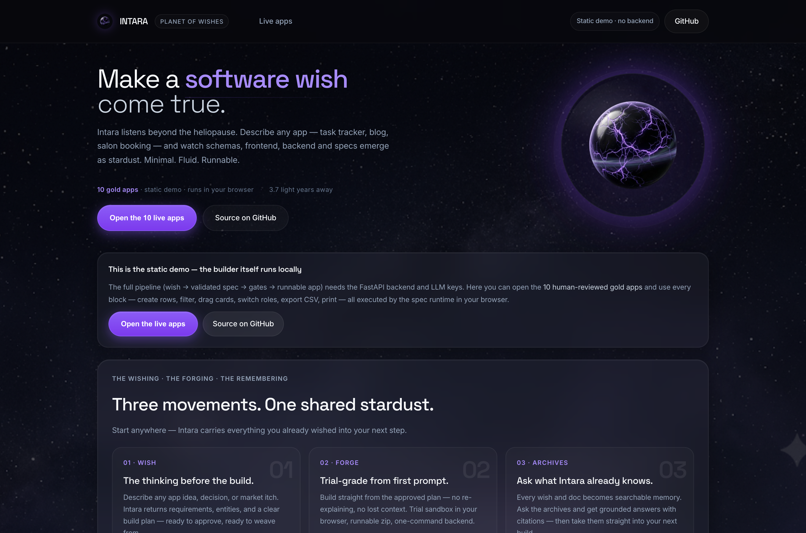
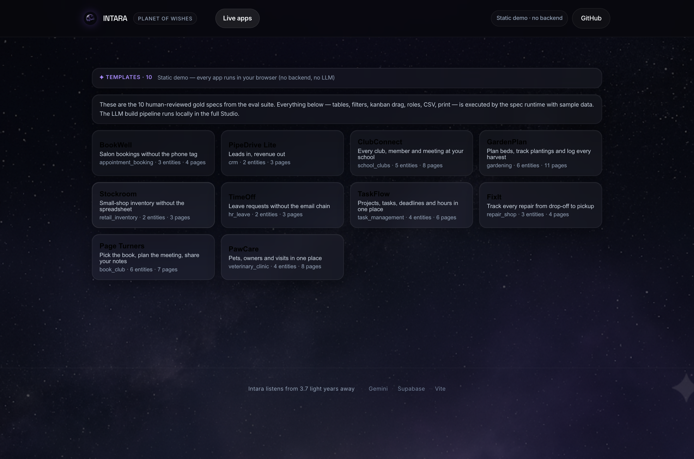
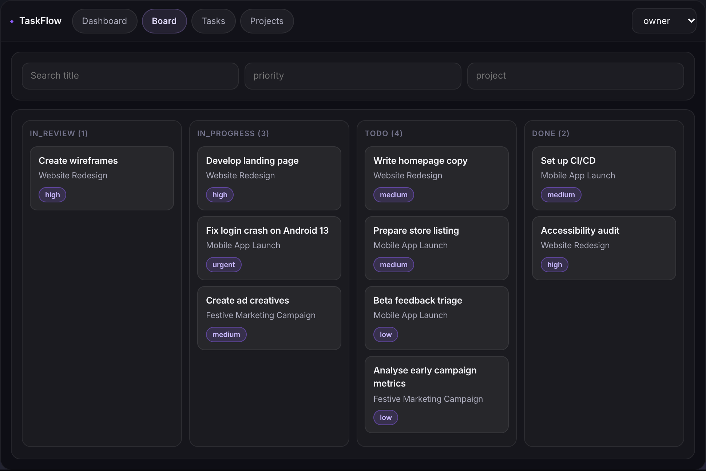

# Intara — make a software wish come true

**Describe an app in plain English → a staged LLM pipeline emits a validated JSON App Spec → a tested runtime executes it as a working app in your browser.**

[](https://github.com/Huzefman/Intara-Propmpt-to-App/actions/workflows/ci.yml)

> **Live:** [intara-propmpt-to-app.vercel.app](https://intara-propmpt-to-app.vercel.app/) — public landing page and template gallery; sign in for the private Studio.
>
> **Backend health:** [intara-api.onrender.com/health](https://intara-api.onrender.com/health)



## What this is

Intara is a prompt-to-app generator built around one bet: **LLMs should not write your app code — they should write small, typed, validated JSON specs, and a tested engine should run them.** Code is an export target, not the product.

The repo contains the whole system: the LLM pipeline, a durable resumable run engine, a TypeScript spec runtime (data, screens, roles, formulas, automations), deterministic gates, and an eval harness — with 470+ automated tests and measured results below.

```
 wish ("a task tracker with roles, deadlines and a board view")
   │
   ▼
┌─ pipeline: typed JSON at every stage · repair loops · fail-closed gates ──┐
│  S0 intake → S1 clarify → S2 model → S3 design → S4 logic → S5 assemble    │
│  G0 schema · G1 semantic lint (R01–R50) · G2 coverage · G3 generated tests │
└────────────────────────────────────┬──────────────────────────────────────┘
                                     ▼
                         App Spec — validated, versioned JSON
                                     │
                  ┌──────────────────┴───────────────────┐
                  ▼                                      ▼
      spec runtime (TypeScript)                 export targets
  data · screens · roles · formulas ·     (runnable Vite + FastAPI zip —
  automations · CSV · print — in-browser   the legacy export path, deferred
                                            until it clears the same gates)
```

## How it works

- **Spec-first runtime.** LLM stages emit small typed App Specs; the runtime engine (validation, defaults, computed fields, refs, permissions, guards, formulas) executes them. No LLM at runtime — the engine is deterministic and statically tested.
- **Staged pipeline, fail-closed.** S0 intake → S6 seed with schema-validated outputs at every stage, bounded repair loops (≤2, cooling temperatures), and deterministic fallbacks that are labelled and counted as failures — never silent.
- **Gates, not guesses.** G0 schema (Pydantic/TS generated from one JSON Schema plus a drift check) · G1 semantic lint R01–R50 · G2 requirement coverage · G3 generated engine tests · G4 render smoke.
- **Durable run engine.** Budgets, content-addressed artifacts, resume-after-crash by run id (proven by an integration test that kills a run mid-build), and per-call telemetry. Retry reuses the same run id and persisted inputs.
- **Groq builds, Gemini archives.** The shared app-build gateway is pinned to Groq in the public deployment (`LLM_ONLY=groq`); the Archives use Gemini for synthesis and embeddings. Provider fallbacks remain available for other deployments.
- **Accounts and bring-your-own-key.** Every visitor gets a private, owner-scoped workspace. Build quotas are off by default while the demo is in development; `BUILD_QUOTA_ENABLED=1` restores a per-account daily cap after migration 012. Add a key from any supported provider (Gemini, OpenRouter, Groq, NVIDIA, DeepSeek, OpenAI, Anthropic, or a custom OpenAI-compatible endpoint) on the Account page. Keys are encrypted with Fernet, service-key only, never returned to the browser, and BYOK calls never silently fall back to the shared pool.
- **Own formula language.** Hand-written parser and evaluator in Python **and** TypeScript — no `eval` — with 135 shared conformance cases plus a 500-input fuzzer. Edits are RFC 6902 JSON patches with invert and a version tree (1,175/1,175 randomized round-trips).

## Measured numbers (free-tier lab runs)

| Metric | Result |
|---|---|
| Golden wishes suite (`eval.py --mocked`) | **5/5** |
| core20 live eval (20 real wishes, end-to-end) | **17/20** (85% accept bar) |
| Held-out domains never tuned for (invoicing, gym, helpdesk) | **3/5** green |
| Curated gold specs in the gallery | **10** |
| Python tests / Node tests | **285/285** · **207 pass** (+1 environment skip) |
| Formula conformance cases (shared Python/TypeScript) | **135** + fuzzing |
| Live Supabase adapter contract | **6/6** |

The interesting failures are documented in [`docs/RESULTS.md`](docs/RESULTS.md): a silent template fallback that hid a 0% parse rate, eval overfitting, and a "hollow resume" bug.

## Run it yourself

**Static template demo (no backend, no keys):**

```bash
cd react-prompt-app
npm install
VITE_DEMO=1 npm run build && npm run preview
```

This serves the 10 curated gold apps entirely in the browser.

**Full Studio (build from a wish — needs the backend):**

```bash
cd server
python -m venv .venv && source .venv/bin/activate
pip install -r requirements.txt
cp .env.example .env        # add Supabase credentials; provider keys are optional
uvicorn main:app --port 8000

cd ../react-prompt-app
npm install
cp .env.example .env
npm run dev                  # http://localhost:5173
```

Without provider keys the planner uses a deterministic mock and the deterministic generators still produce a runnable app.

## Accounts, quotas and keys

- Email/password signup is instant; each account is single-owner with no teams or sharing.
- Public: landing page, template gallery and Archives. Gated: wishes, Constellation, builds, runs and statistics.
- Quotas are **off by default** during development. To enable the shared-pool limiter, apply migration 012 (`build_events`) and set `BUILD_QUOTA_ENABLED=1`; `DAILY_BUILD_LIMIT` (default 3) then caps builds per account per UTC day. A BYOK account bypasses the shared meter.
- Saved keys are tried first. If a BYOK call fails, the build fails with an explicit error — it never silently spends the shared pool.
- Deployment details for Supabase, Render and Vercel are in [`docs/DEPLOY.md`](docs/DEPLOY.md).

## Architecture & Prior Art

Intara's backend service architecture, pipeline design, and testing methodology are developed around established production patterns and academic literature in generative AI systems:

- **Alireza Parandeh (2025).** *Building Generative AI Services with FastAPI: Production-Ready Applications from Conception to Deployment*. O'Reilly Media.
  - **Layered Onion Architecture:** Clean boundaries isolating HTTP transport ([`routers/`](server/routers)), orchestration ([`controllers/`](server/controllers)), core compilation & guardrails ([`services/`](server/services)), and database access (`gates.py`).
  - **Schema & Type Safety:** Strict Pydantic v2 data transfer objects across all ingress, egress, and intermediate generation phases.
  - **Testing Trophy:** 490+ automated tests combining static typing, modular Pytest fixtures, parameterized matrix tests, and hermetic mock evaluations without live network dependencies during CI.
  - **Resilience:** Non-blocking asynchronous I/O, exponential backoff retries with Tenacity, and AES-256-GCM encrypted BYOK tenant key management.

- **Gabriel Poesia, Alex Polozov, Rishabh Singh, Tao Xie (ICLR 2022).** *Synchromesh: Reliable Code Generation from Pre-trained Language Models*.
  - **Constrained Decoding:** LLMs emit typed JSON App Specs rather than unconstrained raw code, guaranteeing syntactically valid structures.

- **Noah Shinn, Federico Cassano, Ashwin Gopinath, Karthik Narasimhan, Shunyu Yao (NeurIPS 2023).** *Reflexion: Language Agents with Verbal Reinforcement Learning*.
  - **Fail-Closed Verification:** Multi-tier guardrail ladder (G0–G4, R01–R50 lint rules) with bounded repair loops to catch and heal structural anomalies before code assembly.

- **Lei Wang et al. (ACL 2023).** *Plan-and-Solve Prompting: Improving Zero-Shot Chain-of-Thought Reasoning by Large Language Models*.
  - **Hierarchical Decomposition:** Breaking prompt-to-app synthesis into discrete sub-stages (S0 intake → S1 clarify → S2 model → S3 design → S4 logic → S5 assemble).

## Limitations

1. **Free-tier quota dominates failures.** Roughly half of observed live-eval failures are quota-shaped (daily caps, congestion). A paid key removes this class outright.
2. **Role coherence has no automatic repair.** Mismatches fail closed at assembly with specific errors.
3. **Single-worker fragility.** One uvicorn worker; a heavy build can stall `/health`.
4. **No hosting or publish path inside the app.** The preview and the downloadable code are siblings, not the same artifact.
5. **Validation is still early.** The numbers above are lab numbers, not product metrics.





## Project docs

- [`docs/RESULTS.md`](docs/RESULTS.md) — measured eval results and failure write-ups
- [`docs/BENCHMARK.md`](docs/BENCHMARK.md) — benchmark suite and acceptance checks
- [`docs/DEPLOY.md`](docs/DEPLOY.md) — Supabase + Render + Vercel deployment
- [`LICENSE`](LICENSE) — MIT

---

Built by **Huzefa Mandviwala** · [GitHub](https://github.com/Huzefman)
