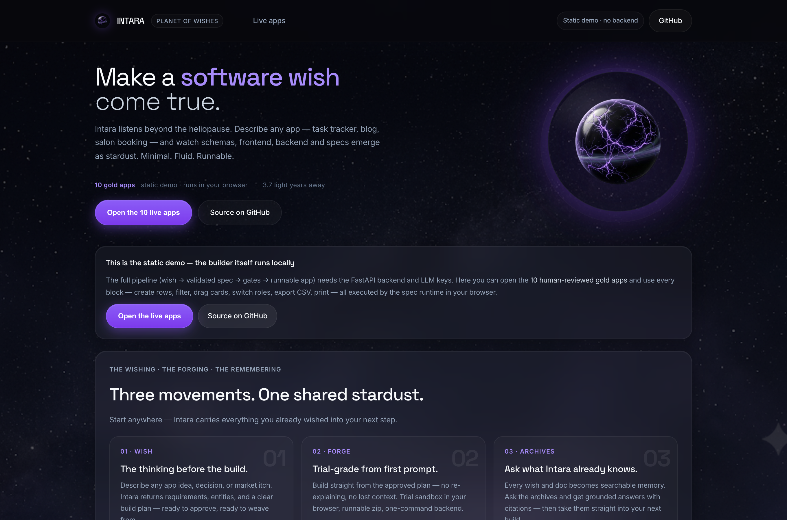
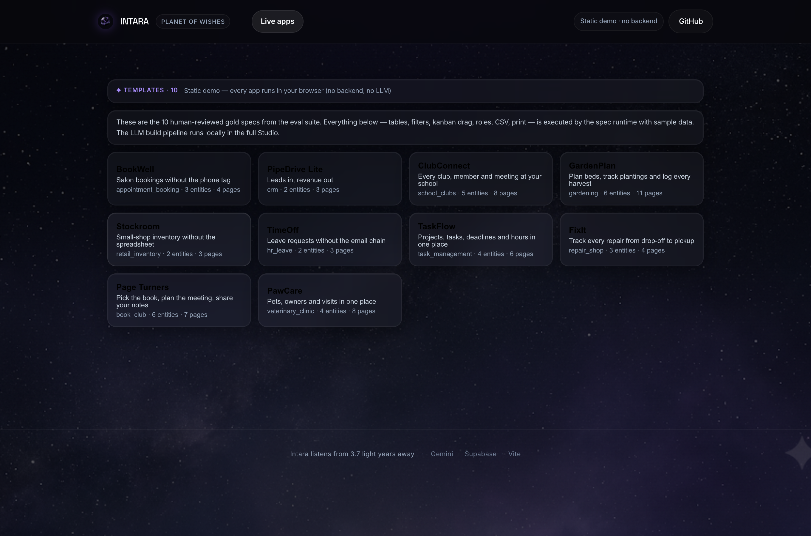
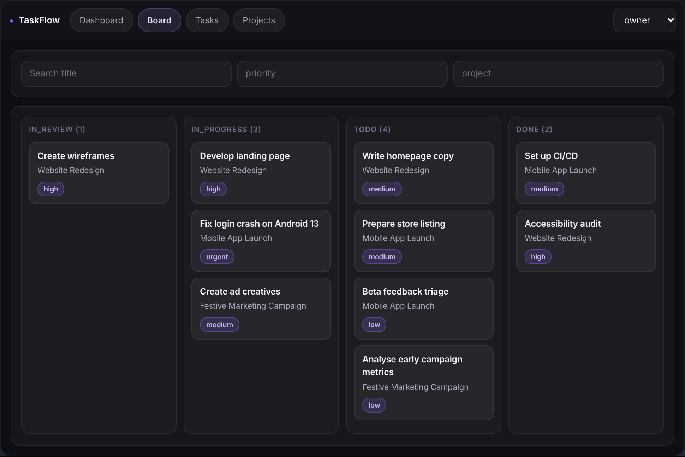

# Intara — make a software wish come true

**Describe an app in plain English → an LLM pipeline emits a validated JSON App Spec → a tested runtime executes it as a working app in your browser.**

[](https://github.com/Huzefman/intara/actions/workflows/ci.yml)

> **▶ Live demo:** _deployment pending — static demo steps in [`docs/process/DEPLOY.md`](docs/process/DEPLOY.md); the account-based app (private Studio, public landing + templates) deploys with [`docs/process/DEPLOY_ACCOUNTS.md`](docs/process/DEPLOY_ACCOUNTS.md)_ (10 human-reviewed apps, fully in-browser, no backend)
> **🎥 2-minute walkthrough:** script in [`docs/process/DEMO_SCRIPT.md`](docs/process/DEMO_SCRIPT.md) — video link lands here once recorded



## What this is

Intara is a prompt-to-app generator built around one bet: **LLMs should not write your app code — they should write small, typed, validated JSON specs, and a tested engine should run them.** Code is an export target, not the product.

The repo contains the whole system: the LLM pipeline, a durable resumable run engine, a TypeScript spec runtime (data, screens, roles, formulas, automations), deterministic gates, and an eval harness — with ~400 automated tests and measured numbers below.

```
 wish ("a task tracker with roles, deadlines and a board view")
   │
   ▼
┌─ pipeline: typed JSON at every stage · repair loops · fail-closed gates ──┐
│  S0 intake → S1 clarify → S2 model → S3 design → S4 logic → S5 assemble    │
│  G0 schema · G1 semantic lint (R01–R50) · G2 coverage · G3 generated tests │
└────────────────────────────────────┬──────────────────────────────────────┘
                                     ▼
                         App Spec — validated, versioned JSON
                                     │
                  ┌──────────────────┴───────────────────┐
                  ▼                                      ▼
      spec runtime (TypeScript)                 export targets
  data · screens · roles · formulas ·     (runnable Vite + FastAPI zip —
  automations · CSV · print — in-browser   the legacy Track B path, deferred
                                            for users until validated)
```

## How it works (the parts worth talking about)

- **Spec-first runtime.** LLM stages emit small typed App Specs; the runtime engine (validation, defaults, computed fields, refs, permissions, guards, formulas) executes them. No LLM at runtime — the engine is deterministic and statically tested.
- **Staged pipeline, fail-closed.** S0 intake → S6 seed with schema-validated outputs at every stage, bounded repair loops (≤2, cooling temperatures), and deterministic fallbacks that are *labelled and counted as failures* — never silent.
- **Gates, not vibes.** G0 schema (Pydantic/TS generated from one JSON Schema + drift check) · G1 semantic lint R01–R50 (ported from two human review rounds) · G2 requirement coverage · G3 generated engine tests · G4 render smoke.
- **Durable run engine.** Budgets, content-addressed artifacts, resume-after-crash by run id (proven live: a killed run resumed and finished), quota-aware retries across free-tier providers (Gemini / Groq / OpenRouter / Nvidia), per-call telemetry — 429 live calls analysed in [`notebooks/telemetry.ipynb`](notebooks/telemetry.ipynb) (provider mix, failure causes, latency, truncation).
- **Accounts + bring-your-own-key.** Every visitor gets a private, owner-scoped workspace. The shared free pool is capped at 3 builds/day; add a key from any supported provider (Gemini, OpenRouter, Groq, NVIDIA, DeepSeek, OpenAI, Anthropic, or a custom OpenAI-compatible endpoint) on the Account page for unlimited builds. Keys are encrypted with Fernet, service-key only, never returned to the browser, and BYOK calls never silently fall back to the shared pool.
- **Own formula language.** Hand-written parser + evaluator in Python **and** TypeScript — no `eval` — with 135 shared conformance cases plus a 500-input fuzzer. Edits are RFC 6902 JSON patches with invert + version tree (1,175/1,175 randomized round-trips).

## Measured numbers (free-tier, lab)

| Metric | Result |
|---|---|
| Golden wishes suite (`eval.py --mocked`) | **5/5** |
| core20 live eval (20 real wishes, end-to-end) | **17/20** (85% accept bar) |
| Held-out domains never tuned for (invoicing, gym, helpdesk) | **3/5** green |
| Human-reviewed gold specs in the gallery | **10** |
| Python tests / Node tests | **266/266** · **206 pass** (+1 env-skip) |
| Formula conformance cases (shared Py/TS) | **135** + fuzzing |
| Live Supabase adapter contract | **6/6** |

The interesting failures are documented in the results write-up (`docs/RESULTS.md`): a silent template fallback that hid a 0% parse rate (0/10 full plans on the first baseline), eval overfitting, and a "hollow resume" bug.

## Run it yourself

**Static demo (no backend, no keys):**

```bash
cd react-prompt-app
npm install
VITE_DEMO=1 npm run build && npm run preview   # the 10 gold apps, fully in-browser
```

**Full Studio (build from a wish — needs the backend):**

```bash
cd server && pip install -r requirements.txt && uvicorn main:app --port 8000   # no keys? deterministic mock, still passes the eval
cd ../react-prompt-app && npm install && npm run dev                            # http://localhost:5173
```

Optional keys (all free-tier) go in `server/.env`; without them the planner uses a mock and the deterministic generators still produce a runnable app.

## Limitations (short list — [full list, no softening](docs/process/PROJECT_HANDOFF.md#6-limitations--the-full-list-no-softening))

1. **Free-tier quota dominates failures.** ~Half of observed live-eval failures are quota-shaped (daily caps, congestion). A paid key removes this class outright.
2. **Role coherence has no automatic repair.** Mismatches fail closed at assembly with specific errors.
3. **Single-worker fragility.** One uvicorn worker; a heavy build can stall `/health`. Demo-grade, not user-grade.
4. **No hosting/publish path inside the app.** The preview (spec) and the downloadable code are siblings, not the same artifact.
5. **No real user validation yet.** The numbers above are lab numbers. That gap is stated, not hidden.



## Built with AI coding agents — said plainly

In 2026 that is normal; what matters is what is true. **I specified the architecture, the gates, the eval methodology and the quota strategy; AI coding agents wrote most of the code; I ran the evals and verified the results.** Every number in this README is measured by the tests in this repo, and the process is auditable: the session ledger records each change, each failure and each fix.



---

Built by **Huzefa Mandviwala** — B.Tech AI & DS, SCET Surat · [LICENSE](LICENSE)

<sub>Process docs (build ledger, decisions, architecture, results, interview prep): [`docs/process/AGENT.md`](docs/process/AGENT.md) · [`docs/RESULTS.md`](docs/RESULTS.md) · [`docs/process/PROJECT_HANDOFF.md`](docs/process/PROJECT_HANDOFF.md) · [`docs/process/INTARA_ARCHITECTURE_GUIDE.md`](docs/process/INTARA_ARCHITECTURE_GUIDE.md) · [`docs/process/OWNERSHIP_TEST.md`](docs/process/OWNERSHIP_TEST.md)</sub>
